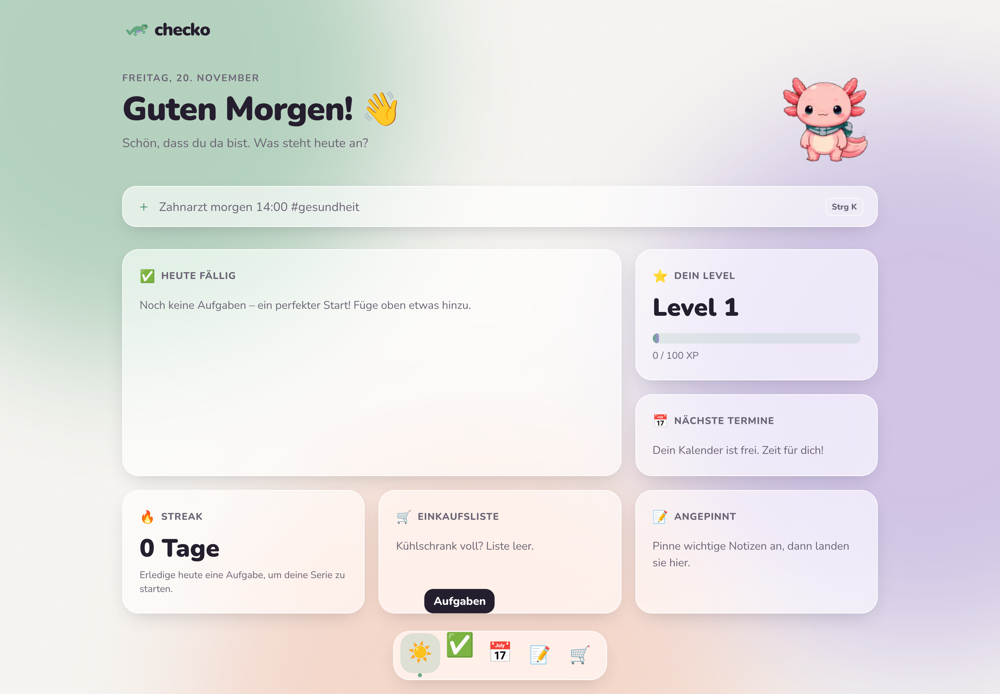

# Checko 🦎✅

Ein verspielter persönlicher Organizer – To‑Dos, Kalender, Notizen, Einkaufsliste und Erinnerungen – komplett in **Rust** (Leptos + WebAssembly).



## Starten

Einmalig einrichten:

```bash
rustup target add wasm32-unknown-unknown
cargo install trunk --locked
npm install
```

Entwicklungsserver (lädt bei Änderungen automatisch neu):

```bash
cd crates/web && trunk serve --open
```

Dann <http://127.0.0.1:8080> öffnen.

## Prüfen

```bash
cargo test -p checko-core
cargo clippy --workspace --target wasm32-unknown-unknown -- -D warnings
```

## Aufbau

| Ordner | Inhalt |
|---|---|
| `crates/core` | Datenmodelle, XP/Level‑Logik (pure Rust, getestet) |
| `crates/web` | Leptos‑Web‑App: Seiten, Komponenten, Tailwind‑Styles |
| `assets/` | Logo, Icon, Axolotl‑Sprites |
| `docs/` | Plan, Master‑Prompt, Screenshots |

Mehr im [Plan](docs/PLAN.md).
